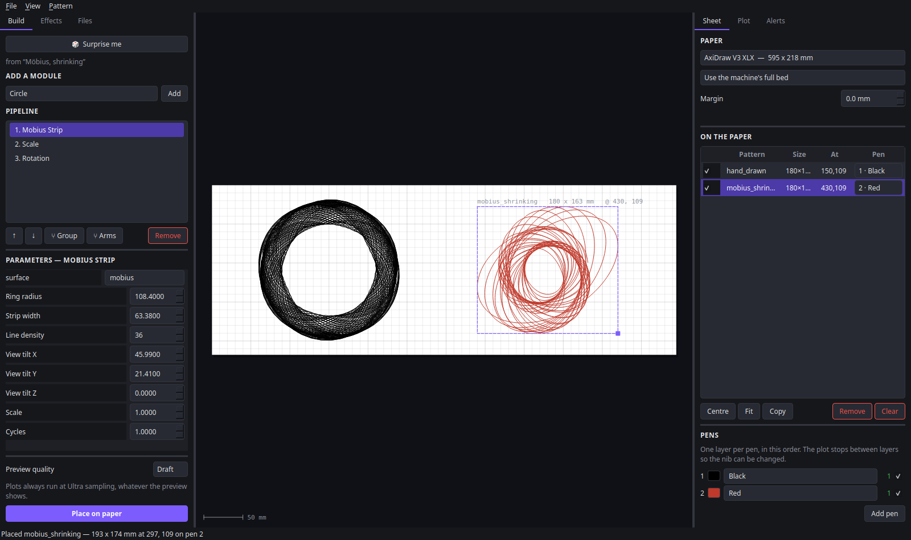
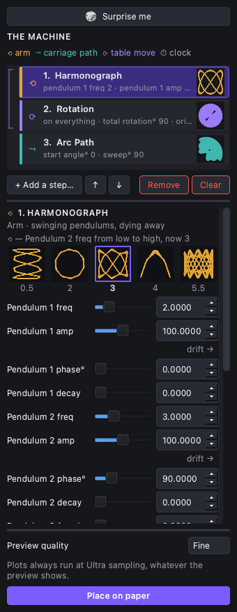
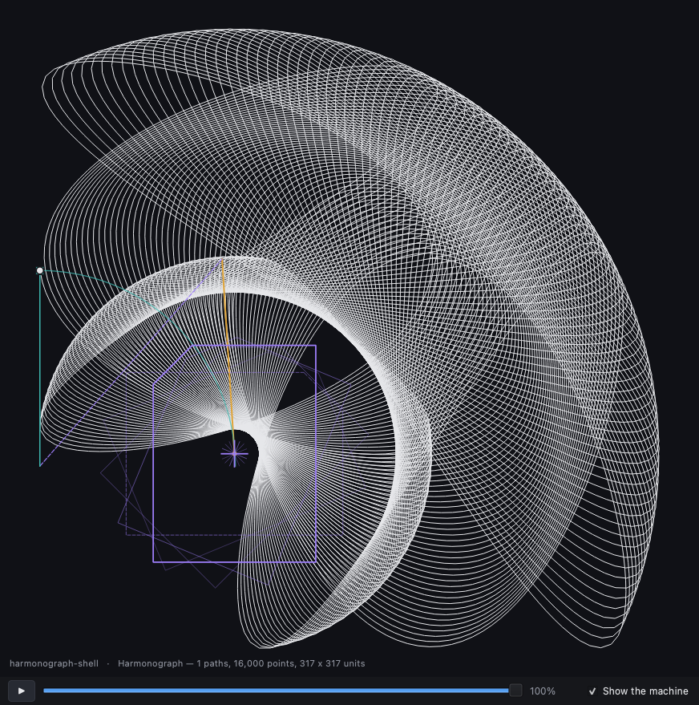
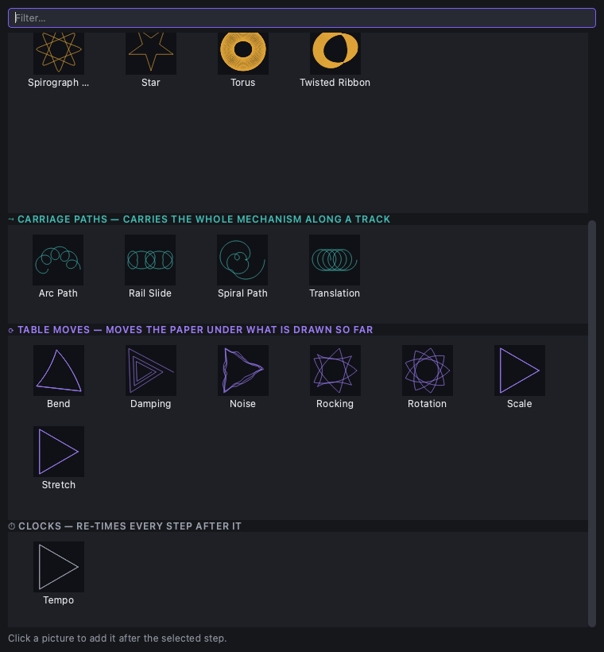
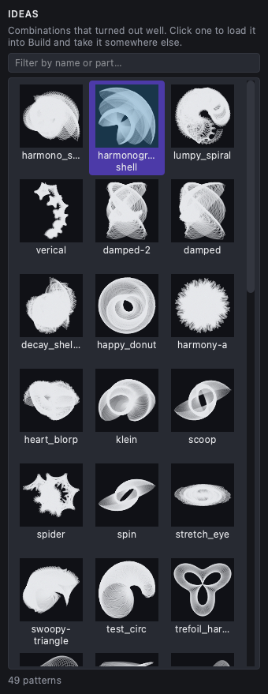
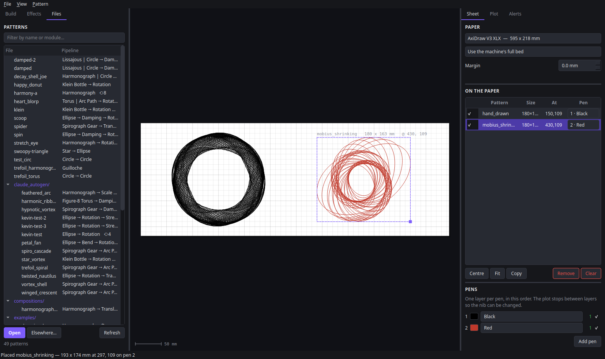
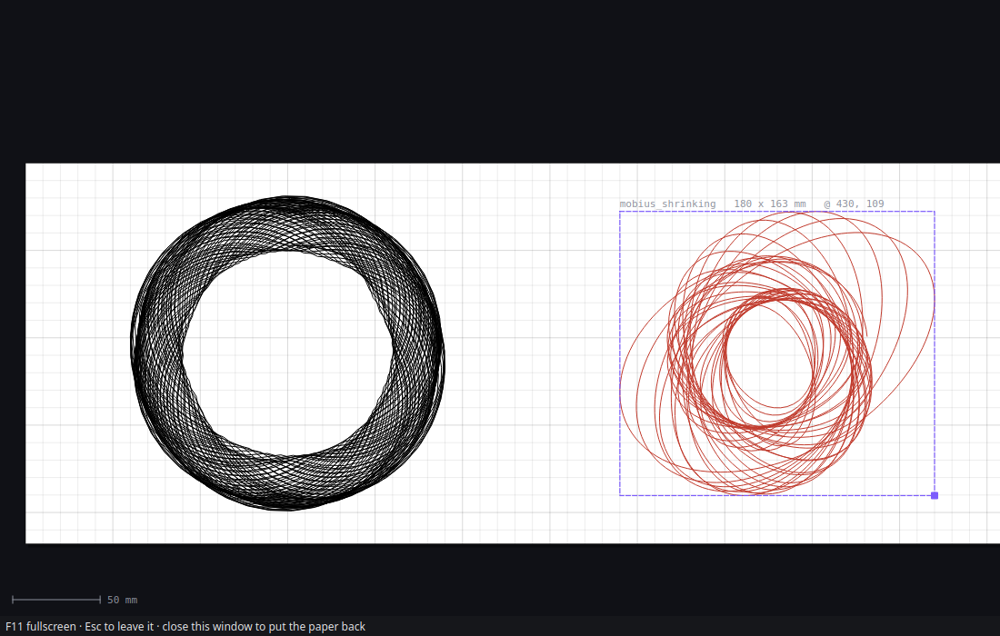

# Spirograph Generator

A modular system for creating complex mathematical art through composed transformations — a digital spirograph toy where you can stack effects, run parallel drawing arms, and smoothly drift parameters to create patterns impossible with physical tools.


*Harmonograph + circle + translation running as simultaneous parallel arms, with rotation and parameter drift*

## The app

```bash
./run_gui.sh                    # open an empty pattern
./run_gui.sh some.ini           # open a pattern file
./run_gui.sh some.sheet.json    # open a saved sheet — patterns placed on paper
```

(`./launch.sh` still works and hands over to the same thing.)

Three columns: **build** the pattern on the left, look at it and arrange it in
the middle, drive the **machine** on the right.



The middle column has two tabs. **Render** (`Ctrl+1`) is the pattern being
built, on its own, redrawn as you change it — no millimetres, just the shape.
**Paper** (`Ctrl+2`) is a real sheet. It is drawn at a known number of pixels
per millimetre, and every pattern on it is drawn through the same transform
that writes the SVG the plotter gets — so a pattern 90 mm wide sitting 120 mm
from the left edge is drawn 90 mm wide, 120 mm from the left edge, and *plots
there*. Drag moves it by the millimetres the pointer crossed; the corner handle
resizes it; the knob standing above its top edge turns it, snapping to a whole
degree, or to fifteen with shift, with a protractor drawn while you turn. Arrow
keys nudge by one, shift by a tenth; `[` and `]` turn by a degree, shift by
fifteen; and the Turn box on the right takes an exact angle down to a tenth. A scale bar at the bottom says what the zoom means.
Anything that reaches past the drawable area turns red and says so before you
plot it.

On first run the script builds `.venv/` and installs PySide6, NumPy and the
[AxiDraw API](https://cdn.evilmadscientist.com/dl/ad/public/AxiDraw_API.zip);
without the last one the app still runs and the plotter controls say why not.

### What it does

The pattern is a **machine**, and the window says so in four colours:

* ⟲ **arm** (amber) — adds a moving arm; the pen rides the last one. Circle,
  gear, harmonograph, pintograph, the wire surfaces…
* ⤳ **carriage path** (teal) — carries the whole mechanism along a line, an
  arc, a spiral, a rail. Sliding along commutes with the arms, so where it
  sits in the order makes no difference — unless an arc or spiral is set to
  **turn with the track**, when it also turns the arms above it to face
  along the track, like a car carrying them round a bend.
  The **Ring carrier** is the nested-ring toy: a ring rolling round inside
  a fixed ring, carrying the steps before it in a bore that can be set
  off-centre (that is the rings-2-and-3 setting on the toy). It always
  turns what it carries, and a carrier before a carrier is a ring in a
  ring in a ring.
  The **Crank & rod** arm is the linkage real drawing machines are built
  from: a crank pushing a rod whose far end slides on a track, with the pen
  on the rod — it draws eggs and teardrops, which an ellipse cannot. An
  Ellipse or Circle can be **pinned at its end** instead of its centre, so it
  grows and tilts about a fixed tip, like a pen arm on a pivot.
* ⟳ **table move** (violet) — turns, grows, bends or wobbles the paper under
  what is drawn so far. Every table move says what it *acts on*: everything,
  or only the last arm (or last few) — the bracket beside the steps shows it.
* ⏱ **clock** (grey) — re-times every step after it: backwards, there and
  back, in steps, faster.

A real machine is never perfectly regular, and that is much of what makes
its drawings look made. Any drifting number can **slip ±%** — wander at
random, slowly, by up to that much of itself — and a Rotation can **slip ±°**
the way an uneven turntable does. A Rotation can also turn by **loops per
turn** of the first arm rather than a total angle: just over a whole number
(13.007) bunches the loops into that many petal fans. `gandy-9175.ini`, after
James Nolan Gandy's drawing machine (jamesnolangandy.com, @gandyworks), uses
all of it.

**Build** — the machine as a strip of steps, each with a picture of the
drawing *as it stands after that step*. **Add a step…** opens a gallery of
what every module draws. Click a step and its numbers appear underneath,
with a slider beside every bounded one and a drift control (once, or there
and back) on every parameter that can move over the draw. The slider's
range is the range worth sweeping, not a limit: type a bigger number and it
is taken, and the slider grows to hold it. (More repetitions want more
points — raise Preview quality, and remember a plot samples for the paper,
not the screen.) Hover any number
and the **explainer** above the list shows that knob as pictures: the step
on its own, rendered at five values from low to high with the current one
marked — so "wave oscillations" or "pen hole" is something you can see
before you touch it. **Finishing** — symmetry, pen lift, moiré, tile, clip
— sits under the steps, because it happens after the ink is down. **Clear**
empties the machine.



**One pattern in Build, one live copy on the paper.** *Place on paper* puts
what you are building on the sheet and links the two, so an edit redraws it
there. *New pattern* starts a fresh one and leaves the paper alone — place
one, start another, place that. Clicking a pattern on the paper brings it
back into Build. *Take off the paper* — the red × on the selection, the
Delete key, Remove in the sheet list, or the button in Build — takes it off
the sheet and leaves it in Build, so nothing is ever lost by it. Emptying
the machine takes its own copy off too: an empty machine draws nothing, and
a picture no pipeline can make again has no business on the sheet.

**Render** shows the pattern and, over it, the machine: each arm as a
segment in its colour from the pivot it turns on; a carriage path as the
track it runs on, with the carriage riding it and the arms hanging from the
carriage; a table move as the paper itself — a violet frame drawn where the
paper was and where the move has put it at this moment, so a rotation turns
it, a scale grows it, a bend bends it. Drag the scrubber (or press play)
and the arms turn while the ink lays down. Pick a step on the left and what
it contributes is drawn over the finished curve: an arm's own curve, a
path's track, a table move's frame.





**Ideas** — every pattern in the project drawn small, the hand-made ones
first, with what each is made of in the machine's words. Click one to load
it and take it somewhere else.



**Surprise me** (`Ctrl+R`) builds a pipeline from one of sixty-one recipes —
ratios that close, decay rates that spiral rather than collapse, gear pairs
whose common divisor leaves lobes instead of a smear — with a range around each
number wide enough to keep surprising you. It says which recipe it used, and it
does not repeat itself until it has been through most of them.

**Library** — every `.ini` in the project with its pipeline beside it, and every
`.sheet.json` with what is on it, filtered as you type, one click to load.
**File → Open…** (`Ctrl+O`) shows every pattern and sheet as a picture,
newest first, with when each was saved — a sheet drawn as its paper with
each pattern in its pen's ink. Filter by name or part; **Other location…**
reaches a file outside the project.



**Sheet** — pick an AxiDraw model or a paper size, set a margin, and place as
many patterns as you like. Each one carries a **pen**; the pen list says what
that pen number means in ink and in name. The selected pattern's centre,
width and angle are there as numbers for when dragging is not exact enough.
Selecting a pattern — in the list or on the paper — brings its pipeline into
Build, linked, so a change there redraws it on the paper and in Render.
*Clear* takes everything off the sheet and leaves the pattern, the pens and
the paper as they are.

**Add text…** (`Ctrl+T`, or the Sheet tab) puts words on the paper: the
size is the height of a capital in millimetres, any angle, lines aligned
left, centre or right. The single-line (Hershey) fonts are what a pen draws
best — each stroke once; any installed font can be used too, drawn round its
outline. Text drags, scales and turns like a pattern; double-click it to
change the words. A pattern or text turns red on the paper only when its
pen lines — not the box round them — reach past the drawable area.

The paper and the pattern in Build are kept between launches: they are
written a moment after each change and come back when the window opens, so
quitting or a crash loses nothing. That is not a saved file — **Save sheet**
is what keeps an arrangement under a name.

**Save sheet** (`Ctrl+Alt+S`) writes the whole arrangement — the paper, the
pens, and every pattern with its pipeline, position, size, angle and pen — to
a `.sheet.json`. Opening it (**File → Open…**, or one click in Library) brings
it back exactly, regenerating the curves in the background. The file holds
pipelines, not points, so it is a few kilobytes however much is on the paper.

**Plot** — speeds, pen positions, path reordering, manual jogging. *Estimate*
motion-plans every layer without opening the serial port. *Dry run* rehearses
the whole job with the pen up. *Plot* draws it, one layer per pen, stopping
between them to ask for the next nib — and remembering which layers are already
on the paper, so a stopped plot resumes rather than drawing them twice.

**Alerts** — Home Assistant, MQTT or a webhook, told when each layer finishes
and which pen goes in next, so the wait happens somewhere other than beside the
machine.

### Room for the paper

A sheet 600 mm across does not want to share a window with two panels.

* **`F11`** hides the side panels and gives the sheet the whole window.
* **`Ctrl+Shift+P`** puts the paper in a window of its own — drag it to a
  second monitor, `F11` there for fullscreen, close it to bring it back. It is
  the same canvas widget, reparented, never a copy: two canvases would be two
  opinions about where a pattern is, which is the bug this program was
  rewritten to stop having.



## How it is put together

```
spiro/pipeline/    the mathematics: the module table, INI <-> a pipeline
                   spec, the engine that runs one, and the randomizer's
                   recipes. No Qt, no plotter.
spiro/scene/       the sheet, in millimetres: paper, a placed item's box and
                   the one transform that places it, pens, and the SVG.
spiro/ui/          the window: canvas, panels, and the two worker threads.
axiplot/           the pen plotter, standalone — the in-process AxiDraw
                   driver, the layer loop, path optimisation, notifications.
                   Vendored from busy-python; see axiplot/VENDOR.md.
*.py at the root   the generators themselves (arc, harmonograph, rose, ...).
```

One millimetre is one unit throughout, and one user unit in the SVG that
reaches the machine. There are no percentages of a widget anywhere in it.

```bash
./run_tests.sh            # every gate: 562 checks, no hardware, no network
./run_tests.sh scene      # just one
.venv/bin/python tests/eyetest_gui.py   # the window as pictures, one per step
```

The last one is the eyetest: it drives the window offscreen and saves a PNG
of every state into `tests/eyetest-results/gui/`. Assertions cannot see a
bracket on the wrong rows or a strip that hides its third step; the pictures
are the test, and each one is read before a change to the window is called
done.

## Command Line

```bash
# Generate from an INI file
python main.py examples/spirograph_gear_simple.ini

# PNG output (requires cairosvg)
python main.py examples/harmonograph_simple.ini --png output.png

# Generate all examples
./generate_all.sh --output-dir ./output
```

## How It Works

### Pipeline Composition

Every pattern is a pipeline of modules. Generators create shapes, transforms modify them, and the output of each feeds into the next:

```ini
[pipeline]
modules = spirograph_gear, rotation, arc
```

*"Generate a spirograph, rotate it while drawing, slide it along an arc."*

### Parallel Arms (Groups)

Modules separated by `|` in a group run simultaneously from the origin and their outputs sum — like independent drawing arms on a mechanical machine:

```ini
[arm]
type = group
modules = harmonograph | circle | translation
```

Each branch can itself be a serial chain:

```ini
[arm]
type = group
modules = gear1, slow_rotation | gear2, fast_rotation
```

### Parameter Drift

Any parameter with an `end_*` variant smoothly interpolates over the draw. Instead of discrete copies, the value changes continuously as the pen moves:

```ini
[gear]
type = spirograph_gear
hole_position = 0.3
end_hole_position = 0.9    # drifts from 0.3 → 0.9 over the draw
tooth_pitch = 1.0
end_tooth_pitch = 2.5      # drifts from 1.0 → 2.5 over the draw
```

### Changed by hand

Any numeric parameter can be changed part-way through the draw, the way a person
swaps a pulley while the machine runs, moves a pin along its slot, or re-clamps
the paper. Write `switch_<name> = moment value, moment value` with each moment a
fraction of the draw; in the app, the ✋ beside a knob opens the same row.

```ini
[crank]
type = pintograph
turns_1 = 7
switch_turns_1 = 0.5 9       # from half-way, nine turns per draw
```

On a rate (a pintograph's turns, a rotation's total degrees) only the speed
steps and the shaft stays where it was. On anything else the value jumps.

### Runs, not one line

James Nolan Gandy's drawings are mostly several runs: a set of loops, the table
turned by hand, another set. The pieces are a `tempo` in `stutter` mode with
`dwell = 1` (the table indexed by hand, the next position taken between one
sample and the next), a `rotation` after it for the positions to lie round, a
`scale` with `scope = 1` oscillating once per run for the loop's swell, and a
threshold `pen_lift` to cut the line where the pen was lifted. Sample in time
(`use_arc_length = false`) so the jump stays one long step for the lift to
find. `gandy-9175-v15.ini` is the worked example; "Runs by hand" under
Surprise me builds one.

### Inks

```ini
[output]
inks = #000000, #c0392b, #1f6fb4   # the pens, in order
ink_changes = 0.3, 0.6             # where the machine was stopped to swap them
ink_advance = 0.004                # run on with the pen up this far after each swap
holidays = 0.5-0.53                # the pen up, and down again, with no swap
ink_flow = 0.5                     # the line darker where the pen moved slowly
```

The machine never stops drawing its pattern; what changes is whether the pen
is down, and which pen. Each pen starts where the last stopped, or a gap after
it when `ink_advance` says the operator nudged the machine on before
restarting; a change written `0.3-0.34` has its own gap. A holiday is the pen
up and down again with no swap. The strip under the render is this plan drawn
out: drag across it to lift the pen for a stretch, drag a gap's edge to move
it, double-click a gap to close it, Ctrl-click a band to choose its pen.
`ink_flow` weights each run of the line by how slowly the pen moved there, as a
gravity-fed pen does. All of it shows on the screen and in the SVG; the Inks
box under Finishing edits them. Placed on the paper, a pattern with more than
one ink takes a plotter pen per ink, chosen by colour, so the plot stops
between them for the swap.

### Ink density

A fountain pen wets the paper, and after about five passes over one spot the
fibres tear. Before a plot the sheet is simulated in the order the machine
draws it, on a grid of cells half a nib across, counting how many times the
nib has come over each cell; a stroke that would carry a cell past the limit
is lifted over the heavy ink and put down again after it. The lift and the
landing go *inside* the heavy stretch, on the least-inked cell a millimetre or
so in from its edge, so the mark a fountain pen leaves where it lands hides in
ink that is already dense. The pen is never lifted over less than 1.5 mm --
up and straight back down is a landing mark for nothing -- so a shorter heavy
stretch is drawn through, unless that would tear the paper, in which case the
lift is stretched over the dense ink round it. No crumb shorter than 6 mm is
put down where it can be helped: two lifts with only a crumb between them
become one longer lift, and a crumb at either end of a line is left off -- but
only where other ink already covers it; on bare paper it is drawn, since
leaving it off would put a white gap in the line. A long line (one spirograph
can be a single path metres long) is walked 25 mm at a time, so what decides a
lift is the ink actually drawn so far, never passes the line itself left off;
counting those is what once left white holes in the dense hearts.
The drawn pieces are then counted again from scratch; if the paper would still
tear, the pen is lifted sooner and lands closer to the edge, and it is all
simulated again. A few cells one pass over the limit -- twenty at most, a
handful of touches, not a band -- are let through rather than cutting the plot
at every crossing to clear them. What it did is one line in the status bar when the job is
built, and anything it could not fix is said there too.

That is the "hold every spot to the limit" way, and it lifts a great deal: a
spirograph whose heart has thirty passes gets cut at every crossing of it. The
paper tears, though, only in the few densest spots, so the sheet's other way --
**thin the densest spots**, the default -- finds the three densest places on the
paper (ink blurred over a millimetre, spots at least 12 mm apart, each reaching
out to where the ink falls to half its peak) and leaves off a share of the
crossings through each, 30% to begin with, spread evenly through the plot.
Everything else is drawn as it is. The pen lifts where a crossing enters the
spot and lands where it leaves, at the edge of ink already heavy enough to
hide the marks; a crossing that alone marks some stretch of paper is never left
off, nor one too short to be worth a lift.

Either way, **the pen lands only in dense ink.** A fountain pen leaves a dot
where it lands, and a row of them along a lightly-drawn rim reads as a thick
black stroke. So a lift or a landing is allowed only where the ink across the
dot's own footprint (a 0.75 mm box) already averages two passes; a stretch
that cannot be lifted over on those terms is drawn through, and the report
says so rather than landing on light paper to meet the limit. spiro_cascade: 304 lifts instead
of 1,659, 95% of the line drawn, the worst spot from 35 passes to 28. The
status line names the spots and what was left off.

The Sheet tab has the nib width (a Kakuno fine is 0.3 mm), the passes the paper
takes, and a switch for the guard; a sheet file keeps them. The screen draws
every line; only the plot is lifted. `spiro/scene/density.py` is the whole of
it, and has no Qt in it.

## Generators

| Module | Description |
|--------|-------------|
| `spirograph_gear` | Classic two-gear spirograph (hypotrochoid/epitrochoid) |
| `harmonograph` | Pendulum simulator — 2–4 pendulums with decay |
| `lissajous` | Frequency-ratio curves (figure-8s, pretzels) |
| `rose` | Rhodonea petal patterns: r = cos(k·θ) |
| `circle` | Simple circle with radius drift |
| `polygon` | Regular polygons (triangle, hex, etc.) |
| `star_shape` | Pointed stars with inner/outer radii |
| `spiral_shape` | Archimedean spirals |
| `ellipse` | Oval with independent X/Y radii |
| `surface` | 3D parametric surfaces (torus, Möbius, Klein bottle, etc.) |
| `line` | Straight lines with timing control |
| `rack` | Gear rolling around stadium-shaped track |
| `spirograph_rail` | Gear rolling along a linear rail |

## Transforms

| Module | Description |
|--------|-------------|
| `rotation` | Spin the pattern around a point as it draws |
| `scale` | Grow or shrink over time |
| `translation` | Slide along a straight line |
| `arc` | Slide along a circular arc |
| `spiral_arc` | Slide along a spiral path |
| `ring_carrier` | A ring rolling in a fixed ring, carrying the earlier steps in an off-centre bore |
| `bend` | Warp flat geometry into a curve (X→angle, Y→radius) |
| `damping` | Exponential decay envelope — pattern spirals toward a point |
| `noise` | Smooth random perturbation (hand-drawn look) |

## Configuration

```ini
[output]
width = 800
height = 800
stroke_width = 0.3
stroke_color = #000000
background_color = #ffffff
margin = 0.08

[sampling]
initial_samples = 100000   # Dense samples for accuracy
output_samples = 10000     # Final point count after arc-length resampling
use_arc_length = true
```

See `complete.ini` for documentation of every parameter.

## Requirements

- Python 3.8+
- NumPy
- PySide6 (for the app; `run_gui.sh` installs it)
- The [AxiDraw API](https://cdn.evilmadscientist.com/dl/ad/public/AxiDraw_API.zip)
  for plotting; without it everything but the machine works
- Optional: `cairosvg` for PNG export from the command line

## License

MIT
