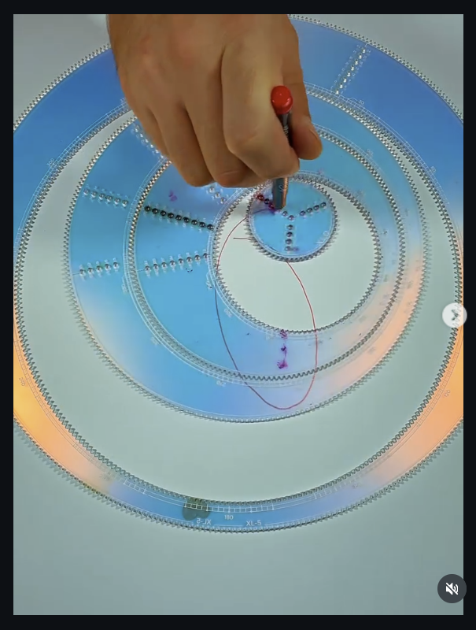

# 01 — Wheel in ring in ring (nested acrylic set)

Video frame (phone, portrait, mute button bottom right). Hand drives a pen through a hole; the set is laser-cut clear acrylic, blue-tinted, Wild Gears style.

## What is on the table

| Part | Teeth | Notes |
|---|---|---|
| Outer ring | 180 (etched "180", "XL-5") | fixed to the paper, teeth on the inside |
| Middle ring | not legible | annular: teeth on BOTH edges, rolls inside the outer ring, carries the small wheel |
| Small wheel | not legible, roughly a third of the middle ring's bore | rolls inside the middle ring's inner teeth, holds the pen |

- Middle ring sits off-centre in the outer ring (touching upper right). Small wheel sits off-centre in the middle ring (touching upper right). Both are free to roll.
- Hole rows: radial spokes of countersunk holes on both rings and the wheel, numbered along the spoke. Same spoke-of-holes layout as the Wild Gears sets.
- The 180-tooth ring also carries a second etched tooth scale on its outer edge (tick marks every tooth, numbers every ten), so it can be used as a wheel in a still larger ring.

## The trace

- One red stroke so far: a tall narrow loop from the small wheel, down past the middle ring's bore, and back up.
- The pen is in the small wheel but the loop reaches outside the small wheel's travel inside the middle ring, so the middle ring is moving under it: this is a two-stage epicyclic (hypotrochoid of a hypotrochoid), not a plain ring-and-wheel figure.
- Purple smears at the top of the small wheel and at the bottom of the middle ring's bore are pen starts from earlier attempts.

## For this project

- `spirograph_gear.py` does one wheel in one ring. This frame is two nested stages: wheel C rolling in ring B while ring B rolls in ring A.
- Closed form: pen = centre_B(t) + rotate(centre_C relative to B) + rotate(hole offset in C), with the B/A ratio from (180 − teeth_B)/teeth_B and the C/B ratio from (bore_B − teeth_C)/teeth_C. The period is the LCM of both stages.
- Nearest existing route in the pipeline: a gear generator fed into a second gear generator as an arm. Worth checking whether the current chaining gives the second stage's rotation, or only its translation.
