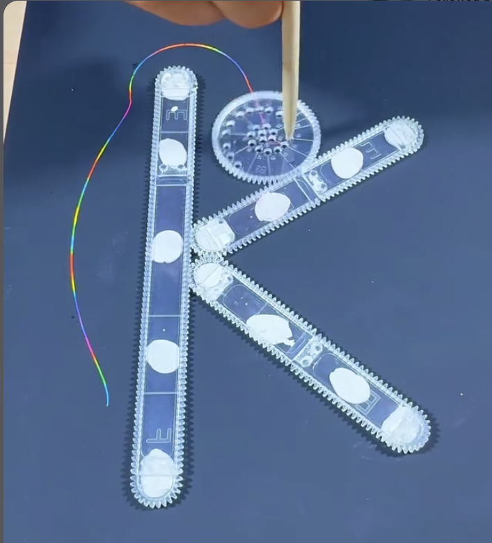

# 02 — Wheel rolling around a letter K built from racks

Video frame (phone, portrait). Dark blue paper. A wheel is pushed around the outside of a capital K assembled from three toothed straight racks.

## What is on the table

| Part | Count | Notes |
|---|---|---|
| Straight racks | 3 | clear acrylic, teeth on both long edges and round both ends (stadium shape); etched letters "E", "F" and a hook mark near the ends; stuck down with white putty blobs |
| Wheel | 1 | clear acrylic, label at the rim not legible (two digits), holes in a radial fan plus a cluster near the hub |
| Pen | multicolour "rainbow" pencil in a hole near the wheel's edge |

- Two racks meet the upright at the same point mid-bar, one going up-right and one going down-right. Where the two diagonal racks touch there is a small gap, so the wheel can follow the outer teeth around the K's concave corners too.
- The rack ends are rounded and toothed, so the wheel goes around each tip as an epitrochoid and along each flat as a curtate trochoid.

## The trace

- One pass so far: from the top of the upright, around its rounded top end (a bump), then down the left flat with the wheel's own wave superimposed on the straight run.
- Colour changes along the stroke are the rainbow pencil, not pen changes; wavelength of the wobble = one wheel revolution = one wheel circumference along the rack.

## For this project

- `rack.py` does a wheel around ONE stadium rack. This frame is a wheel around a compound outline: three racks joined into a K, with convex tips, concave inside corners and a flat-to-flat joint.
- General case = roll a gear along any closed polyline-with-arcs outline. Inside (concave) corners need the gear to pivot about the corner point; outside (convex) corners are the rack-end epitrochoid.
- A letter is the obvious demo: the outline comes from the glyph, the gear and hole give the texture.
