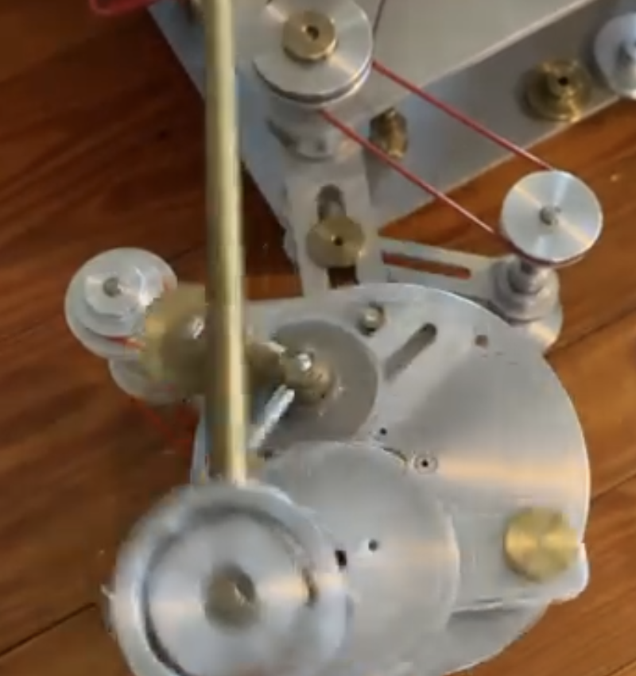
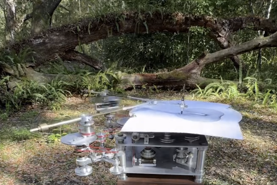

# 03 — Gear-and-pulley drawing machine: crank disc close-up, and the machine in the woods

Two frames from one video, taken 18 s apart. Aluminium plate and disc construction, brass fittings, red round rubber belts, on a wooden base box; the machine matches James Nolan Gandy's gear-and-pulley machines in every visible respect (see the `pintograph` module docstring and `gandy-9175-*.ini`).

## Frame 03 (close-up)

| Part | Notes |
|---|---|
| Large aluminium disc, lower right | the crank disc. A brass pin stands at its rim (about 0.85 of the radius) and there is a radial slot plus drilled holes at several radii between hub and rim, so the crank throw is set by moving the pin |
| Smaller aluminium disc riding on it, lower left | motion-blurred, so it is turning while the big disc is nearly still: the second-stage eccentric (the planet on the carrier the `pintograph` module calls `eccentric_n`). It has a grooved rim, so it is driven by a belt of its own, not by the big disc |
| Brass rod, diagonal across the frame | the drawing arm, hinged at the brass collar on the small disc's hub and running up and out of frame toward the paper |
| Aluminium pulleys on vertical shafts, three visible | joined by red round belts. Two pulleys in the top row, one at the right on a stepped brass hub |
| Slotted aluminium bars | the pulley shafts sit in slots, so centre distance and belt tension are adjustable; the pulley at the right has a slot under it |
| Brass knurled thumb-nuts | on every shaft top; everything is hand-adjustable without tools |
| Stepped brass pulley hubs | two diameters on one shaft = a selectable ratio |

- Drive train: one motor, belts stepping down through pulleys to the crank disc and to the eccentric disc. The ratio between the two stages is what the belt sizes and pulley steps set.
- All adjustment is continuous (slots, pins at chosen radii), not discrete gear teeth. Ratios therefore need not be rational, and patterns need not close.

## Frame 03b (wide, outdoors)

- Machine on a wooden box in a forest clearing, a fallen tree behind. Paper is a white sheet on a plate at top right, held by a clamp bar.
- A long aluminium arm reaches out from the machine to the left, a second arm carries the pen holder (thin vertical rod) over the paper. Two arms meeting at the pen = the two-crank pintograph.
- Stacks of pulleys of different diameters on the base front (step pulleys) and a second belt run to the left arm's crank at bottom left.

## For this project

- This machine is the physical model behind `pintograph.py` (two cranks, two rods, pen at the elbow, with an eccentric second stage on each crank).
- What the close-up adds: the second-stage disc turns much faster than its carrier (blur vs still), so `eccentric_turns_n` is large relative to `turns_n`, and the throw of the main pin is one of a handful of pre-drilled radii plus a slot.
- The outdoor frame shows the pen arm is long compared with the crank throw: arm length to throw ratio looks about 8:1, which keeps the pen path close to the sum of the two circles with little linkage distortion.
