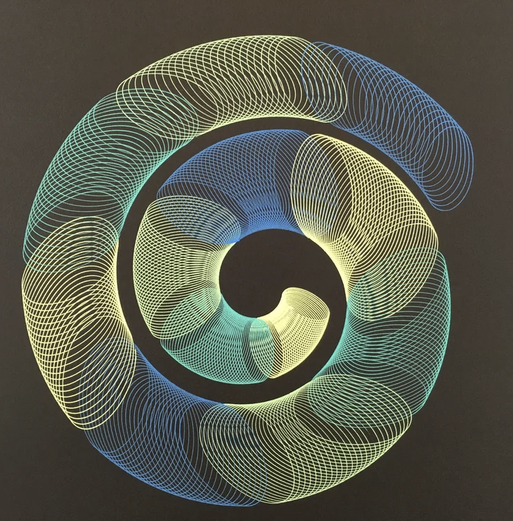

# 04 — Spiral of loops, yellow to blue on black

Finished drawing, square crop from a gallery post. Black paper, gel ink shading from pale yellow through green to blue along the stroke.

| Element | Reading |
|---|---|
| Unit stroke | a near-elliptical loop, about 1/8 of the sheet across |
| Arrangement | loop centre walks an outward spiral of about 1.5 turns; loop size grows with radius |
| Spacing | consecutive loops overlap by most of their width, so their crossings make moiré bands; a clear dark gap separates the spiral's turns |
| Colour | continuous drift yellow → blue → yellow along the spiral, so colour is a function of time: a colour-changing pass or pens swapped at intervals |

- Centre of the spiral is near the sheet centre; the loop's long axis stays tangent to the spiral, so the loop is attached to a turning carrier, not to the sheet.
- Mechanism: fast loop (crank + eccentric) carried by a slow turning table whose radius creeps outward. In this project: `ellipse` loop under `rotation` with a drifting `translation`; same family as the `gandy-9175` ring run, with the radius sweep made continuous instead of stepped.
- `reference/plots/04-snail.ini` is this drawing as a file: an ellipse arm at 150 loops, growing, carried out along a spiral path of a turn and a half and turned with it; five pens swapped at four points, the machine run on with the pen up at each swap, so the colour bands sit apart. The pen plan is the strip under the render; placed on the paper it takes a plotter pen per ink.
