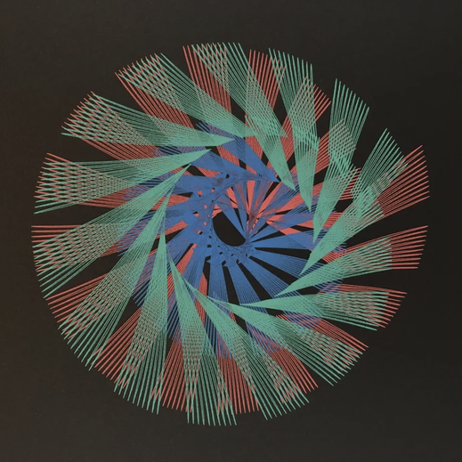

# 05 — Pinwheel of straight fans, teal and red on black

Finished drawing on black paper, two inks: teal and red, with a dense blue-violet core where they overlap.

| Element | Reading |
|---|---|
| Unit stroke | a near-straight line about half a sheet long, repeated with a small angular step, so each cluster is a fan of parallel-ish lines |
| Count | about 22 fans around the sheet, each fan a long wedge leaning the same way: a pinwheel |
| Core | the inner ends of all fans overlap into a tight blue spiral with a hollow at the centre |
| Colour | each fan has both inks side by side, teal outside red, so two passes with the table turned a few degrees between them |

- Straight strokes from a linkage mean a long rod and small crank: the pen end of the rod moves almost on a line while the far end goes round.
- Mechanism in this project: a `line` or `crank_rod` stroke under `symmetry` of order 22 and `rotation`; the lean of the fans is the phase between the stroke and the table step.
