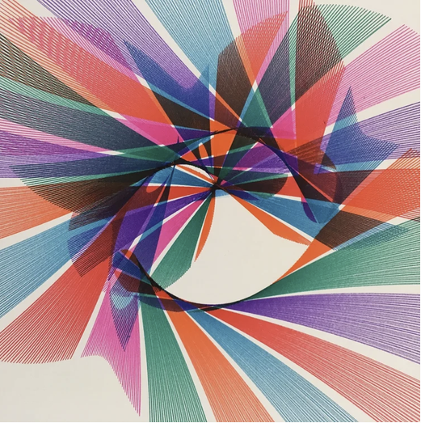

# 06 — Overlapping colour fans on white

Finished drawing on white paper. Six to seven inks: red, orange, magenta, purple, blue, green and black. Lines are fine and dense enough that each fan reads as a flat colour wedge from a distance.

| Element | Reading |
|---|---|
| Unit stroke | a long straight line; successive lines pivot about a common point, so each bundle is a fan (the envelope of a family of lines) |
| Fans | about 20, in several colours, overlapping heavily; where two fans cross the lines interfere into dark moiré |
| Centre | an untouched circle below centre, so the pen never comes within a set radius of the table axis |
| Colour | one ink per pass; the sheet or the crank phase moved between passes |

- Fans with a common pivot come from a rod that swings about a fixed pin while its other end is driven: the pen traces the rod's own sweep.
- Mechanism in this project: `line` stroke whose angle advances per pass; with the untouched centre meaning a minimum radius, so an `ellipse` or `circle` offset outside the axis could drive the line's far end.
