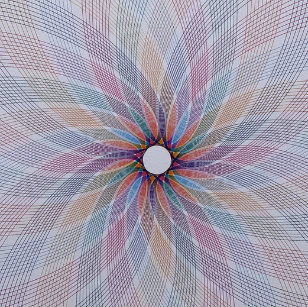

# 07 — Pastel petal rosette on white

Finished drawing on white paper, about six pastel inks (blue, red, orange, green, purple, grey). Overexposed scan, lines are faint.

| Element | Reading |
|---|---|
| Unit stroke | a long narrow loop (a petal), reaching from the centre to the sheet edge |
| Arrangement | petals repeated around the axis at a small fixed step, about 24 around; neighbours overlap into a crosshatch |
| Centre | a clean blank disc: the loop's inner end stops short of the axis by the same amount every time |
| Colour | each colour is a full set of petals; the sets are rotated against each other by a fraction of the petal step |

- Narrow petals with a blank centre are a hypotrochoid family with the pen just inside the rolling wheel's radius, or a loop run on a turning table with the table stepped a fixed angle per loop.
- In this project: `ellipse` with high aspect ratio under `symmetry` of order about 24, or `spirograph_gear` with hole_position near 1 and a ratio that gives ~24 lobes.
