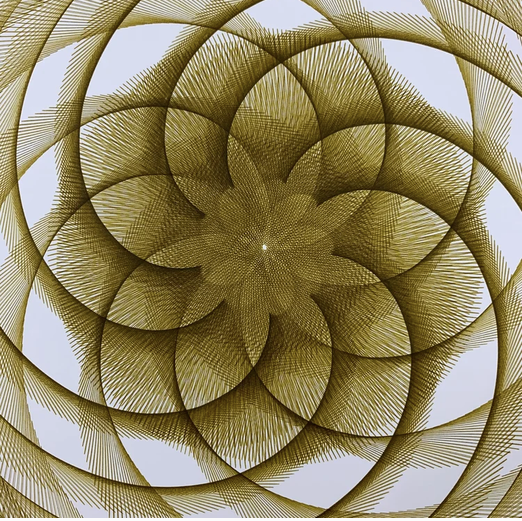

# 08 — Nested hatched rosette in olive on white

Finished drawing on white paper, one olive-gold ink.

| Element | Reading |
|---|---|
| Unit stroke | a short fast oscillation (the hatching), laid along a slow petal path, so every petal is a sheaf of radial lines |
| Slow path | a rosette of large overlapping circles, about six, with a second smaller rosette inside and a single dot at the exact centre |
| Fill | the fast stroke sweeps across each petal as the slow path advances; petal interiors are dense, the edges are the envelope |
| Colour | one ink, one pass |

- Two frequencies well apart: a small crank running fast gives the hatch, a large crank running slowly gives the circles; the ratio between them sets the hatch count per circle.
- In this project: a small `circle` or `line` arm at high cycles chained after a `spirograph_gear` or `rose` path; the project's arc-length resampling will matter at this line density.
