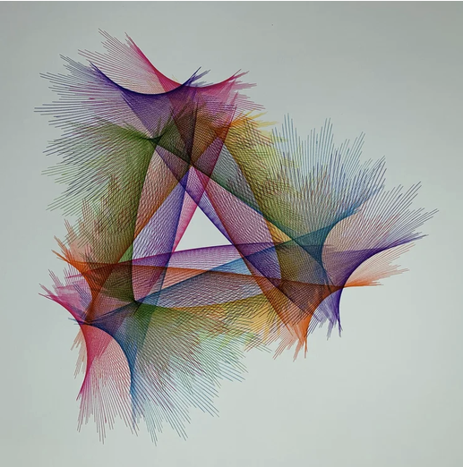

# 09 — Triangular fans in rainbow inks on white

Finished drawing on white paper. Many inks (red, magenta, purple, blue, green, orange) that shade into each other across the sheet.

| Element | Reading |
|---|---|
| Unit stroke | a straight line, swept into fans |
| Slow path | three-fold: a triangle of dense bundles with sprays of rays flaring out at the three corners |
| Colour | continuous gradient across neighbouring strokes, so many passes each in a different ink with a small step between them; colour is time |
| Texture | where bundles cross, moiré; where rays flare, the stroke is sweeping through a corner of the slow path |

- The ray sprays at the corners are what a straight stroke does when the slow path turns sharply: the line keeps its length while its angle swings through the corner.
- In this project: `line` stroke under a 3-lobed slow path (`rose` with k=3, or `symmetry` order 3 on a single loop), with the ink changing every N strokes.
