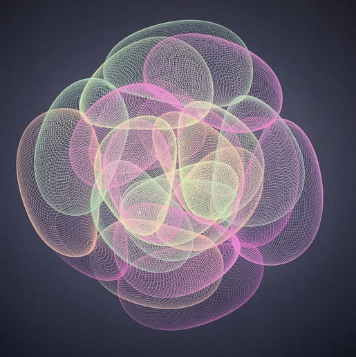

# 10 — Cluster of mesh ovals, pastel on dark grey

Finished drawing on dark grey paper. Three inks: pink, pale yellow, pale green.

| Element | Reading |
|---|---|
| Unit stroke | an oval loop; drawn repeatedly with a tiny offset so each oval is a fine mesh rather than a line |
| Arrangement | a few dozen ovals of different sizes, centres scattered within a round field, overlapping; reads like a cluster of bubbles or a rose |
| Colour | three passes, one per ink; each pass has its own set of ovals |
| Edges | each oval has a bright rim where the mesh lines bunch at the loop's extremes |

- The mesh inside each oval is the signature of a loop that precesses slowly: hundreds of near-identical loops with the phase creeping.
- In this project: `ellipse` at many cycles with slow `rotation`, under a slow `translation` drift that moves the centre; size drift via `scale`. The project's `noise` module would scatter the centres but the real machine's scatter is deterministic.
