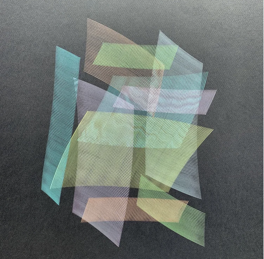

# 11 — Stacked hatched panels, pastel on dark grey

Finished drawing on dark grey paper. Four inks: teal, lavender, peach, olive.

| Element | Reading |
|---|---|
| Unit stroke | a straight line, repeated side by side with a constant step: a hatched panel |
| Panels | about twelve, each a parallelogram or slightly curved strip; different angles and sizes; stacked and overlapping |
| Overlap | crossings make moiré, and the brighter inks over the darker ones read as translucent sheets |
| Colour | one ink per panel, or per group of panels |

- Straight parallel hatching comes from the linear machine (see the Gandy notes): the pen strokes back and forth while the table advances at right angles; the slight curve on some panels is the stroke's arc.
- In this project: `line` stroke with a slow perpendicular `translation`; one panel per layer; rotate and offset each layer.
