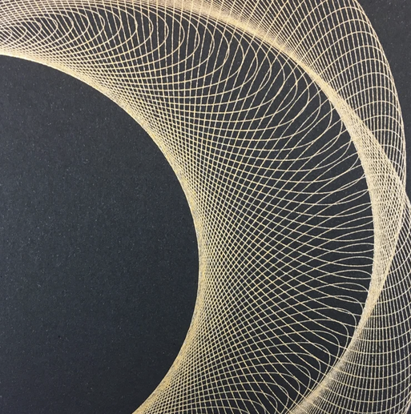

# 12 — Ring of precessing loops, gold on black (crop)

Finished drawing on black paper, one gold ink; this frame is a crop of the lower right of a larger ring.

| Element | Reading |
|---|---|
| Unit stroke | a circle-ish loop about a third of the frame across |
| Arrangement | loop centre walks around a large circle; the loop also turns slowly, so successive loops are offset and rotated: a ring with a braided inner edge |
| Inner edge | the inner envelope of the loops is a clean circle (the dark field), the outer envelope is scalloped |
| Density | loops overlap by most of their width; crossings make a fine net |

- This is the single-ring case of frame 04, without the spiral growth: the `gandy-9175` ring run in this project is a direct attempt at this.
- Two rates: loop rate fast, carrier rate slow; the loop's own rotation relative to the carrier gives the braid.
