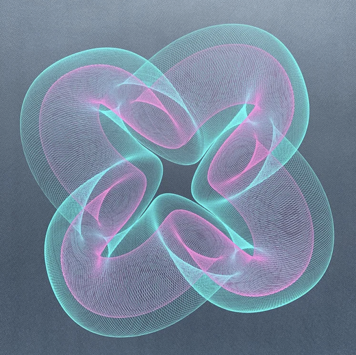

# 13 — Four-lobed tube, cyan and pink on grey

Finished drawing on grey paper. Two inks: cyan and pink.

| Element | Reading |
|---|---|
| Slow path | a four-lobed closed curve (quatrefoil), each lobe a loop that passes through the centre |
| Fast stroke | a small loop swept along the slow path, so each lobe is a tube of fine mesh |
| Passes | cyan with the larger fast loop (fat tube), pink with a smaller one inside it (thin tube), same slow path |
| Centre | the four lobes cross at the axis and the tubes stack there |

- Same construction as `trefoil_torus.ini` in this project, with four lobes instead of three and a second pass at a smaller fast throw.
- In this project: `rose` or `spirograph_gear` giving four lobes, chained with a `circle` arm at high cycles; two layers differing only in the arm radius.
