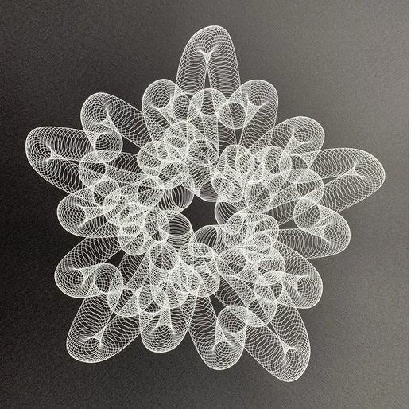

# 14 — Five-pointed looped star, white on black

Finished drawing on black paper, one white ink.

| Element | Reading |
|---|---|
| Slow path | a five-pointed star: five outer lobes, five inner lobes between them |
| Fast stroke | a loop swept along the path; each arm shows two tube bundles side by side, so the path runs each arm twice in different phase |
| Centre | a dense ring where all arms cross |
| Density | high; the tubes are near-solid at the arm tips |

- Fifth-order version of frame 13; the doubled tubes mean the slow path has two traversals before closing (a ratio like 5:2 rather than 5:1).
- In this project: `spirograph_gear` or `rose` with a 5-lobed ratio that closes in two turns, chained with a `circle` arm at high cycles.
