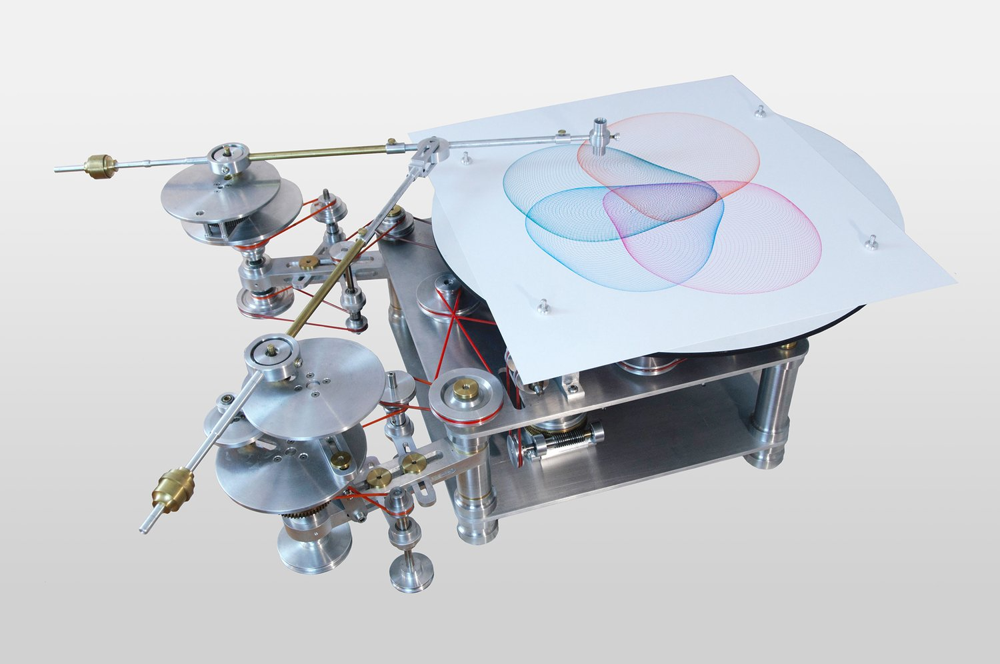

# 15 — Studio photo of a Gandy gear-and-pulley drawing machine

Product photo on a white background (camera file DSC_38122.jpg). The machine in frame 03, seen whole, with a finished drawing still on the table.

| Part | Notes |
|---|---|
| Base | aluminium box on four turned pillars; pulley shafts and belts on the front and sides |
| Table | a black disc under the paper at top right; paper pinned with four push pins; the table is driven by a brass worm at centre right, the slow axis |
| Crank A, top left | large aluminium disc with a brass rod across it; brass knurled counterweight at the rod's far end |
| Crank B, bottom left | two large aluminium discs stacked, the upper one smaller: the two-stage eccentric. Brass rod with a heavier brass counterweight at its end |
| Rods | both brass rods meet at an aluminium elbow above the paper; a short link carries the pen holder down to the sheet at the far end of rod A |
| Belts | red round belts between aluminium pulleys of several diameters; one run is crossed into a figure-eight, which reverses the driven shaft |
| Gears | a brass spur under crank B, and the worm under the table; everything else is belt-driven |
| Adjustment | brass thumb-nuts throughout; crank pins at drilled radii; pulley shafts on slotted bars |

- The drawing on the table: three overlapping lobes in cyan and magenta, each lobe a tube of fine loops, like frame 13 with three lobes.
- This is the full physical model behind `pintograph.py`: two cranks (`radius_n`, `turns_n`), a second-stage eccentric on crank B (`eccentric_n`), rods of unequal length (`arm_1`, `arm_2`) meeting at the pen, plus a slow turning table (`rotation`) under the sheet.
- Rod length to crank radius is roughly 6:1 on crank A and 4:1 on crank B; the pen sits beyond the elbow on rod A, not at the elbow itself.
